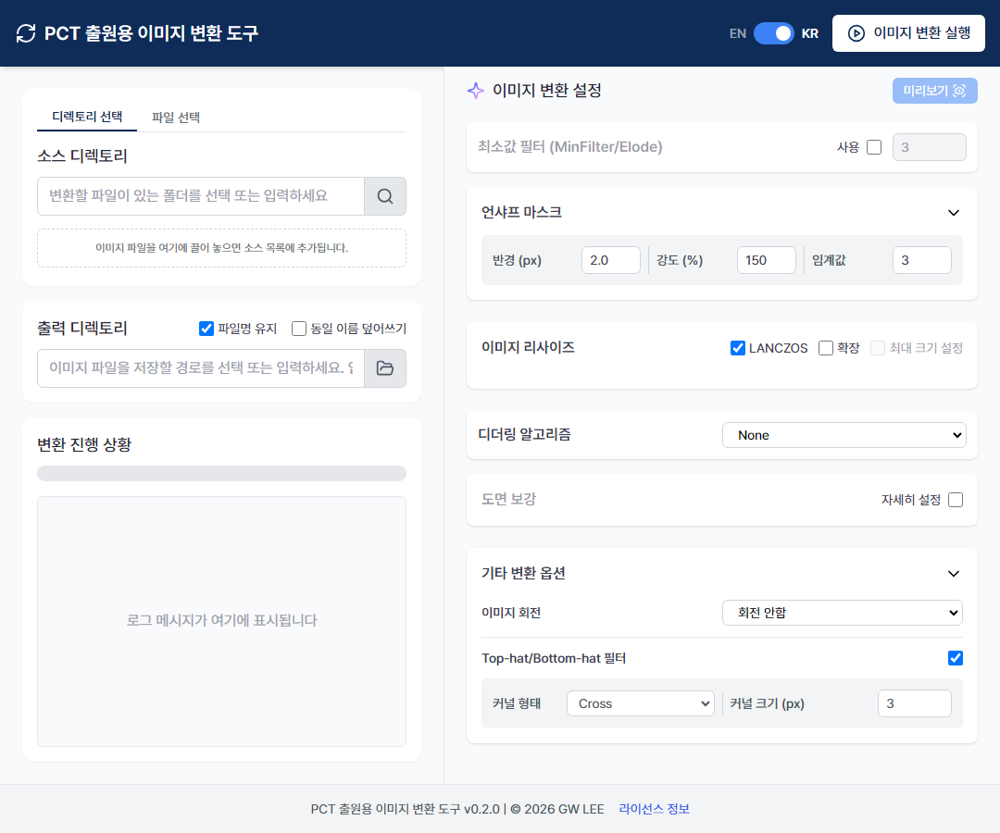

[English](https://github.com/iygfa/PCT-Image-Converter/blob/main/README.md) | **한국어**

## PCT 출원용 TIFF 포맷
도면 이미지 파일들을 <ins>**PCT 국제출원**</ins> 에서 요구하는 사양인 <ins>**Tiff format**</ins> 으로 변환하는 프로그램
- 300dpi
- 170mm x 255mm
- CCITT Group 4 압축
- 1-bit 흑백 이미지
- 인텔식 인코딩
- 싱글 스트립

## 특징
### 위의 사양을 지키면서도, 화질을 위해 필터 탑재
- 언샤프 마스크(Unsharp Mask)
- 최소값 필터(MinFilter, Erode)
- Top-Hat/Bottom-Hat
- 디더링 알고리즘 선택 가능 (Floyd–Steinberg, Atkinson, and Stucki)

### 이미지 크기/방향을 쉽게 변경
- 이미지 가로세로 비율을 유지
- 크기제한(170mm x 255mm)을 초과하는 이미지는 자동으로 축소
- 필요한 경우, 작은 이미지를 확대 가능
- 리사이즈시 LANCZOS 알고리즘 사용 가능
- 좌우 90, 180도 회전 가능

### 그 외
- 실시간으로 미리보기 가능
- 출력폴더가 없는 경우 알아서 생성

## v0.2.0의 새로운 기능 및 개선사항
### 도면 보강
더 구체적인 설정을 통해 흑백전환시 화질을 향상시킬 수 있도록 했습니다.

### 미리보기시 원본 비교 가능
- 미리보기 기능에 원본과 비교할 수 있도록 원본비교 기능을 추가했습니다
- 원본비교시 상하/좌우 배치가 가능합니다 

### 그 외
- 드래그 앤 드롭을 통해 이미지 추가할 수 있도록 했습니다
- 용량을 대폭 줄였습니다
